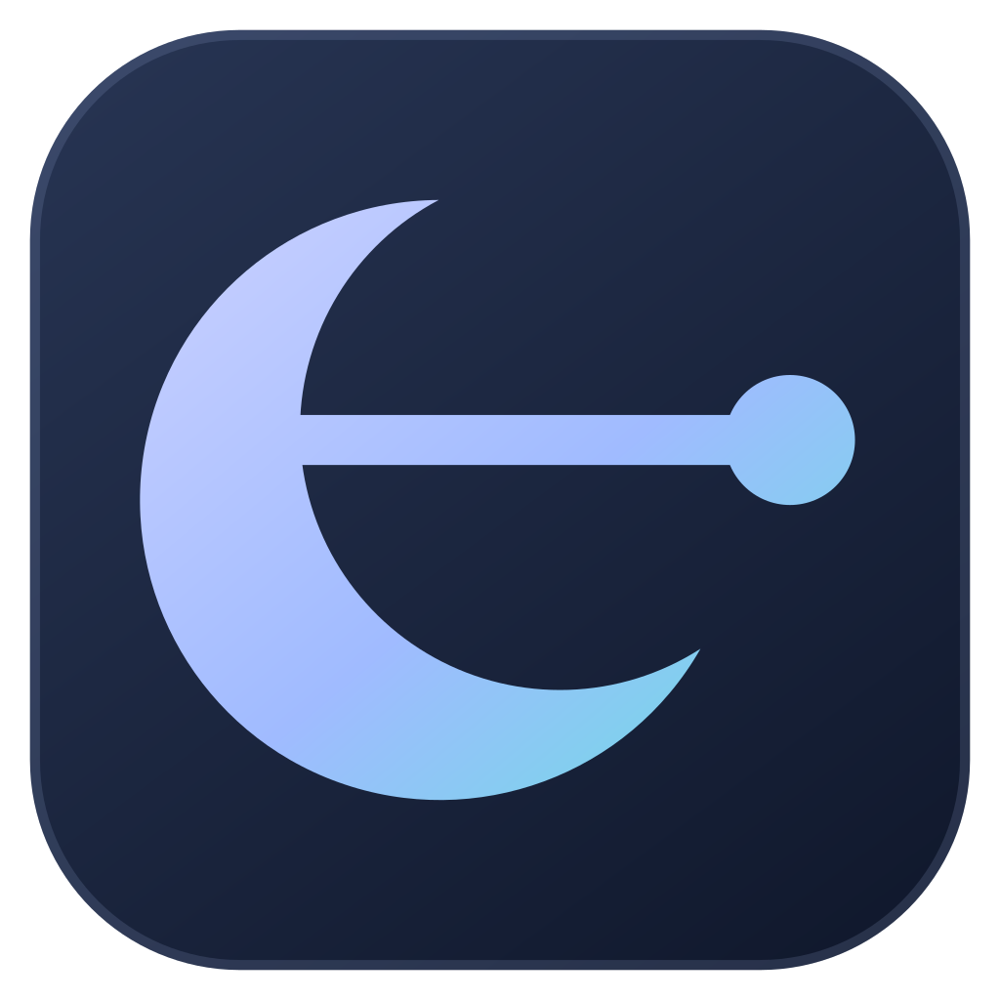

<div align="center">
  
  <h1>Lunport</h1>
  <p><strong>Your SSH workspace.</strong></p>
  <p>Keep your hosts, keys and Groups together.<br />Connect in the app or your preferred terminal. Give AI agents controlled SSH access through MCP.<br />Bring your library to your other devices with encrypted sync.</p>
  <p><a href="https://github.com/ysya/lunport/releases/latest">Download</a> · <a href="docs/usage.md">User guide</a> · <a href="docs/development.md">Development</a> · <a href="https://github.com/ysya/lunport/issues">Issues</a></p>
</div>

Lunport is a desktop SSH workspace for **macOS, Windows and Linux**, formerly named **SSHelter**. It combines a local host library, a private-key vault and a built-in SSH engine with optional encrypted sync and controlled AI access through a built-in **MCP (Model Context Protocol) server**.

> **Upgrading from SSHelter:** Lunport continues the same project with a new name and Folded L icon. Existing data, credentials and command-line integrations keep their established identities. Historical [SSHelter 1.0.0](https://github.com/ysya/lunport/releases/tag/v1.0.0) installers retain their original names; use [Releases](https://github.com/ysya/lunport/releases/latest) for the current Stable.

## A workspace for your connections

- **Hosts and Groups** — organize connections with nested Groups, shared defaults and tags. Search the library, revisit recent hosts and connect from the command palette.
- **SSH terminal in the app** — open session tabs in Lunport or your preferred external terminal, reconnect dropped sessions in the same tab while keeping previous output, search retained output, adjust terminal text size, verify server fingerprints and enter passwords or authentication codes in Lunport. Save host passwords in this device's system credential store when desired. Jump hosts use `ProxyJump`.
- **SSH tunnels** — save Local, Remote and SOCKS5 forwarding rules. Rules sync with your account; each device starts and stops its own connections.
- **Keys in one place** — generate keys or import an OpenSSH private key with the system file picker or by pasting. Imports copy into the local vault and preserve the source file. Managed private keys are included when you approve encrypted library sync.
- **Encrypted library sync** — create an email-named account on your own server (no email verification or email recovery), sign in with a Passkey and set a sync unlock password. Enter the same password once on each new device; hosts, Groups, tunnel rules and managed SSH private keys then sync automatically with end-to-end encryption. Passwords stay on each device. Cloudflare and Docker self-hosting are supported; OIDC is optional.
- **AI access through MCP** — add Codex, Claude Code, Claude Desktop, Cursor or VS Code from Settings, or export configuration for another local agent. Allow individual hosts or Groups, review proposed connections and choose Ask or explicitly acknowledged Auto-log for remote commands. Review request and completion times, including seconds and your local time zone, in **Recent activity**.
- **A home for existing OpenSSH setups** — Legacy mode edits your local SSH configuration while preserving comments, ordering and unknown directives. Migration into the Records library requires an explicit review.
- **Consistent preferences** — searchable settings, six built-in color palettes with independent light/dark/system modes, reduced motion, an animated collapsible sidebar and signed Stable/Beta updates. **Settings → About** collects the installed version, project links and license.

## Install

Choose an installer from [Releases](https://github.com/ysya/lunport/releases/latest). Files ending in `.sig` are updater signatures, not installers.

| Platform | Download |
| --- | --- |
| macOS, Apple Silicon or Intel | Universal `.dmg` |
| Windows x64 | `.exe` installer |
| Linux x64 or ARM64 | `.AppImage`, `.deb` or `.rpm` for your architecture |

**macOS:** builds use a fixed project signing certificate and a fixed **Lunport Credential Helper** for protected credentials. Ordinary App updates retain the same helper. The first use of existing credentials can require **Always Allow** for the helper; a deliberate helper update or changed Keychain policy can require authorization again. See the [Keychain details](docs/2026-10-18-keychain-partition-followup.md). This is not an Apple Developer ID; builds are not yet notarized. Drag Lunport into Applications and, if Gatekeeper blocks it, run:

```bash
xattr -dr com.apple.quarantine /Applications/Lunport.app
```

For the historical SSHelter 1.0.0 app, use `/Applications/SSHelter.app` instead. Subsequent in-app updates do not require this step again.

**Windows:** the installer is not code-signed, so SmartScreen may show a warning. Choose **More info → Run anyway** to proceed. In-app sessions work directly in Lunport. External connections use the installed console helper and Windows Terminal when available, otherwise Command Prompt. See [Windows integrations](docs/usage.md#windows-integrations) for OpenSSH deployment and Git/agent setup.

## Get started

The in-app terminal ships first on the **Beta** channel. Choose **Settings → Updates → Release channel → Beta** to try it.

1. Open the app and use it locally without signing in or creating an account. A new Records library works without an existing `~/.ssh/config`.
2. Add a host, or open **Import** to review and copy entries from an existing SSH configuration.
3. Open **Keys → Import private key → From a file** to choose a key. Pasting a supported OpenSSH private key is also available.
4. Select the host's login key, verify its server fingerprint against a trusted source and double-click the host to connect. Choose **Lunport (in app)** in **Settings → Connections** to use session tabs; existing terminal preferences are preserved.
5. Optionally open **Sync** to connect your devices, or **Settings → AI access → Connect an AI tool** to add your agent and allow selected hosts.

Existing Legacy workspaces keep their OpenSSH files. Use the offered migration review when you are ready to move them into the Records library.

## Self-host sync

Public installers start with a blank Server URL. Deploy your own encrypted sync service with [Cloudflare Workers](relay/security/README.md) or [Docker Compose](relay/selfhost/central/README.md), then enter its HTTPS URL in Sync. See [server configuration](docs/central-server-configuration.md) for first sign-in and changing servers.

## Learn more

- [User guide](docs/usage.md) — connections, keys, sync, MCP and Legacy mode.
- [Development and release workflow](docs/development.md) — local setup, profile isolation, checks and publishing.
- [Self-host encrypted sync](docs/central-server-configuration.md) — Cloudflare Workers or Docker Compose. The server URL starts blank; use your own deployment.
- [Release notes](https://github.com/ysya/lunport/releases) and [changelog](CHANGELOG.md).
- [Rename and upgrade compatibility](src-tauri/installers/README.md).

## License

[PolyForm Noncommercial 1.0.0](LICENSE). Copyright © 2026 Frank Sung.
