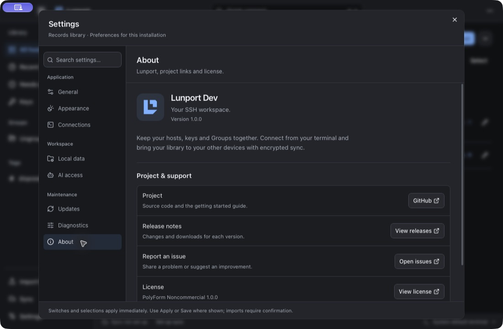
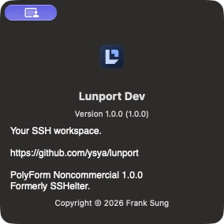
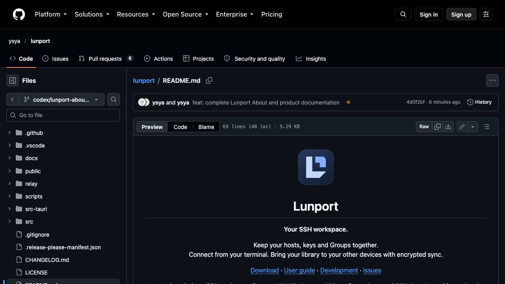

# Lunport About and public documentation

Product source: `4d0f2bf5ecf77350b2a636c0599c279b350fab2e`.

## Result

- GitHub About describes the SSH workspace, hosts, keys, Groups, terminal connections and encrypted library sync. The repository uses GitHub's generated social preview; there is no custom old-brand preview to replace.
- README has the Folded L icon, current product introduction, download formats and a Records-first quick start. It explicitly distinguishes the upcoming Lunport build from the published SSHelter 1.0.0 installers.
- [User guide](usage.md) describes current Records sync and MCP, separate Legacy behavior, Windows integrations, updates and help. It removes the stale requirement to pre-create SSH config for Records and the old beta-only feature claims.
- [Development guide](development.md) covers isolated profiles, brand sources, preserved compatibility identities and release workflows. Published tags, installers and signatures are preserved.
- Settings → About is available in both workspaces and in Settings search, with installed profile name/version, product copy, project/releases/issues/license links and the correct PolyForm Noncommercial license. Updates uses the same mark.
- The macOS native About panel uses the same product metadata for its tagline, project URL, copyright and license. Native menu actions and diagnostic access are retained.

## Local validation

- TypeScript check and Vite production build passed.
- Frontend: 84 test files, 1,071 tests passed, including every Records Settings category without loading Legacy config.
- `cargo check --locked --lib --features development-profile` passed on macOS.
- Release-mode Lunport Dev app bundle built successfully using the Development configuration.
- All local paths and section links in README, user guide, development guide and relay README resolve.
- GitHub rendered README verified: Folded L, Lunport title, tagline and download/guide/development/issues links display correctly.
- Native Development app opened with its existing two disposable hosts and one key; Settings → About showed Lunport Dev, version 1.0.0, Folded L, tagline and project/support/license content. The native About panel showed the same identity and license. The app quit normally and was confirmed not running. No preferences or host/key records were changed.

## CI

The product-source commit is checked by [SSH engine](https://github.com/ysya/lunport/actions/runs/38964914474), [Windows](https://github.com/ysya/lunport/actions/runs/38964914502) and [relay](https://github.com/ysya/lunport/actions/runs/38964914489). Final results are recorded in the adjacent `about/` evidence folder.

The initial Windows run passed 2,407 safe Rust tests (3 ignored, 9 filtered), all three profile builds (3 tests each) and the whole-app build. Its native tray stress test completed four processes, then the fifth reported `STATUS_HEAP_CORRUPTION` after all functional assertions, helper joins and event-loop return. Later Windows GUI/console/SSH steps were skipped. This is a real failed check; it is not counted as a full Windows pass.

The native test has no WebView or production startup plugins and does not load the new About pane or macOS menu. Its test and tray implementation are unchanged from the pre-PR main commit. A manual `native_probe` mode compares ten independent native processes on the candidate and an exact baseline, without weakening the default full Windows workflow or retrying failed native processes. Source refs and outcomes are recorded in CI. Baseline comparison: [run 38968578777](https://github.com/ysya/lunport/actions/runs/38968578777). The exact pre-PR main commit `e83e6580e05fdc56e8425d10959c49791529dbf6` also failed its first native process with `0xc0000005` during event-loop callback cleanup (`tao::...::reset_runner`). The candidate completed all ten independent native processes. These are different exception codes in the same existing native regression path; the comparison establishes pre-existing instability, not a root cause or a fix.

The About/documentation work is validated independently and introduces no Windows native runtime logic. The native stability defect remains open and must be resolved before publishing the next release; do not describe the initial full Windows job or baseline probe as passing. Its logs and outcomes are retained here, rather than suppressing or retrying failed processes until green.

The follow-up changes no installer template, bundle identity, credential service, executable name, persisted path, published release or updater signature. No renamed release is published by this PR.

## Follow-up resolution

The native runtime defect was subsequently reproduced without the tray, repaired with shared context ownership, and validated on the final Lunport 1.1.0 candidate. See [release validation](releases/1.1.0-validation.md) for the failing baseline, repaired regressions and complete platform/installer results. The failed checks above remain historical evidence.
