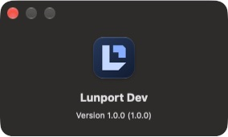

# Lunport 改名與相容性

產品名稱採用 **Lunport**，副標為 **Your SSH workspace.** GitHub 專案已由 ysya/sshelter 改名為 ysya/lunport，repository ID 1264083592 相同，origin 已更新到 git@github.com:ysya/lunport.git。

目前已發布的 Stable 仍為 SSHelter 1.0.0；Lunport 名稱準備納入下一版。未重建或覆寫 1.0.0 的標籤、說明、簽章與安裝檔，歷史驗證文件保留當時的名稱及網址。

## 改名範圍

- Records、Legacy、Keychain、Settings、同步與匯入／部署流程、MCP 審閱、CLI 提示、原生認證／信任／診斷視窗及托盤使用 Lunport。
- Production／Development 的 Tauri product name 及視窗標題分別為 Lunport／Lunport Dev；HTML title、套件說明及目前 README 同步更新。
- 新匯出的偏好檔預設名稱為 lunport-settings.json，匯入仍接受既有設定 envelope。
- 目前使用的 GitHub、relay 部署及更新通道連結改用 ysya/lunport。歷史發布收據保持原貌。
- 新標誌採 Folded L：Lunport 的 L 與連線入口形成兩塊幾何輪廓，切角比例一致。app icon 使用深藍底與兩階藍色；Records、Legacy 及開啟工作區畫面共享同一份單色符號，顏色隨介面主題調整。favicon、macOS ICNS、Windows ICO／Store 圖示及 Linux PNG 同步更新。
- macOS 選單列使用獨立的透明單色圖示，避免 app icon 的底色變成方塊；Windows／Linux 托盤使用彩色 app icon。原始幾何位於 src/brand/lunport-mark.json，執行 node scripts/generate-brand-icons.mjs 可由專案鎖定的 Tauri CLI 重建所有平台圖示。

## 既有使用者的相容性

- Application identifier、資料路徑、金鑰圈服務、localStorage key、SSH include／agent／slot 路徑、IPC／crypto context 保持原值。沒有遷移或改寫使用者資料，也沒有重新授權同步、MCP 或私鑰分享。
- 登入啟動項目使用原本的名稱。sshelter、sshelter.exe 及 Windows sshelter-cli.exe 保留，讓已儲存的 MCP 與終端機指令能繼續使用。
- macOS updater 的現行實作會移除更新壓縮檔的第一層 app 名稱，再寫回目前 bundle 路徑；此點已檢視原始碼，未在本機執行 Production 更新。手動把 app 放到不同位置時，依絕對路徑註冊的 CLI／MCP 指令及登入啟動項目需跟著更新。
- Windows 的 NSIS／MSI 保留舊 registry identity、原安裝位置與 MSI UpgradeCode；Production 和 Development 維持隔離。安裝器範本來源、授權與差異見[說明](../src-tauri/installers/README.md)。
- Linux DEB 以 Provides／Conflicts／Replaces、RPM 以 Provides／Obsoletes 取代舊的 ss-helter 套件；Development 使用獨立的 ss-helter-dev 名稱。
- 舊的 Stable／Beta 更新網址已實際下載比對，與原收據相同；9 個舊套件下載網址均可取得正確的內容片段，對應簽章亦相同。1.0.0 的 20 個 asset ID／名稱／大小／digest 及標籤來源不變。見[repository 改名收據](rebrand/2026-10-17/repository-rename.json)。
- 保留舊 repository 名稱的轉址；不要另外建立新的 ysya/sshelter 專案，以免中斷舊版更新連結。

## 驗證

- 前端 84 檔／1,071 案例、TypeScript 與 production build 通過。完整 safe Rust：macOS 2,601 passed／10 filtered；Linux 2,596 passed／10 filtered，另有 PAM 7 passed；Windows 2,407 passed／3 ignored／9 filtered。三平台各有三組 profile 檢查，每組 3 passed。safe suite 跳過真實金鑰圈寫入，Linux 的 PAM 使用隔離容器。見[macOS／Linux／前端 CI](rebrand/2026-10-17/engine-ci.json)與[完整 Windows CI](rebrand/2026-10-17/windows-ci.json)。
- Windows 完整 CI 另通過十個獨立托盤並行 process、native crash metadata、實際 Development GUI／WebView2 啟動與正常關閉、console helper 8+3 案例、real console pair，以及 runner 上的 OpenSSH client／engine 登入。
- Linux DEB 實際由已發布 1.0.0 升級，RPM 在隔離 package database 驗證套件取代，既有資料與 sshelter CLI 路徑保留。RPM 檢查不代表 RPM 發行版的 GUI／runtime 驗收。見[Linux package CI](rebrand/2026-10-17/linux-package-ci.json)。
- Windows NSIS／MSI 已實際由已發布 1.0.0 原地升級；含空白的原安裝路徑、資料 sentinel、CLI、MSI UpgradeCode 及舊 product 註銷均通過，NSIS 的捷徑與登入啟動設定亦通過。正常解除安裝保留資料。見[升級 CI](rebrand/2026-10-17/windows-upgrade-ci.json)。兩種安裝包的 helper 位置、static CRT、piped／real console production pair 亦通過。見[完整安裝包 CI](rebrand/2026-10-17/windows-bundle-ci.json)。
- 升級檢查找到 MSI 範本的 Handlebars 轉義問題：製造商 placeholder 被當作文字，導致舊目錄查詢失效。已修正，並檢查實際產生的 WiX XML 不含未展開的 expression、兩個目錄查詢均使用舊 registry namespace。修正後的安裝檔以已驗證且來源未改動的 runtime 重新打包，保留來源與 SHA-256 收據；沒有發布新版本。
- macOS Development 原生啟動、工具列與 About 的 Folded L 圖示已驗收；既有的 2 個測試 hosts／1 個測試 key 正常保留，Settings 名稱、關閉後焦點恢復及正常退出已驗證。沒有安裝或啟動 Production，也沒有修改偏好。見[原生驗收](rebrand/2026-10-17/macos-native.json)與[平台圖示收據](rebrand/2026-10-17/brand-assets.json)。Windows／Linux 的逐畫面人工驗收不包含在套件升級測試內。

