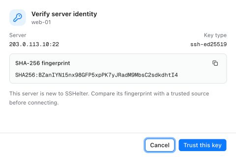
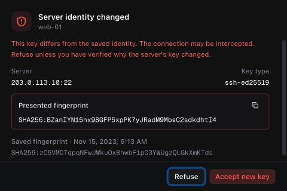
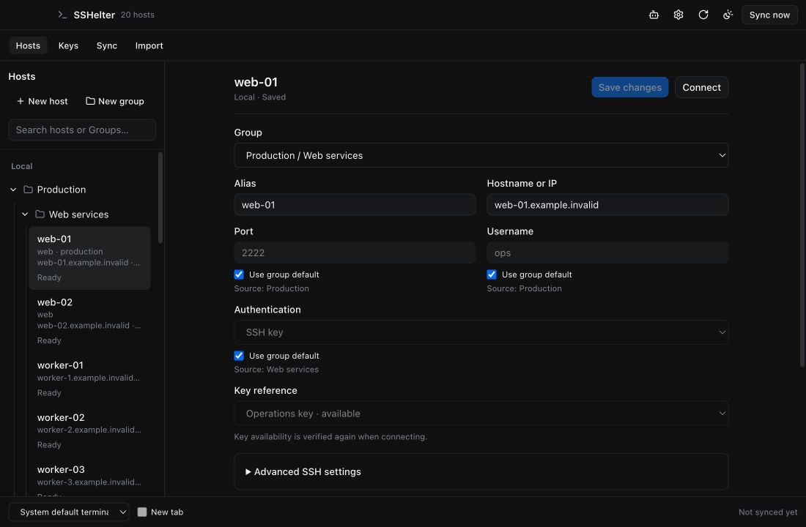
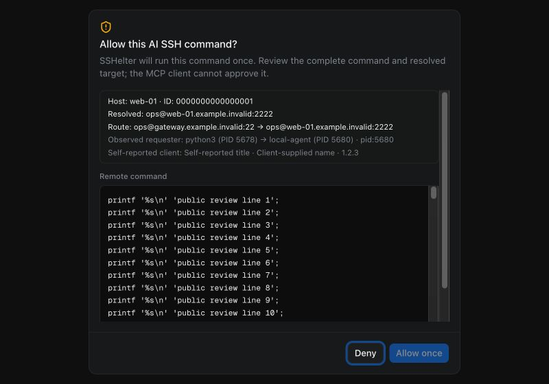
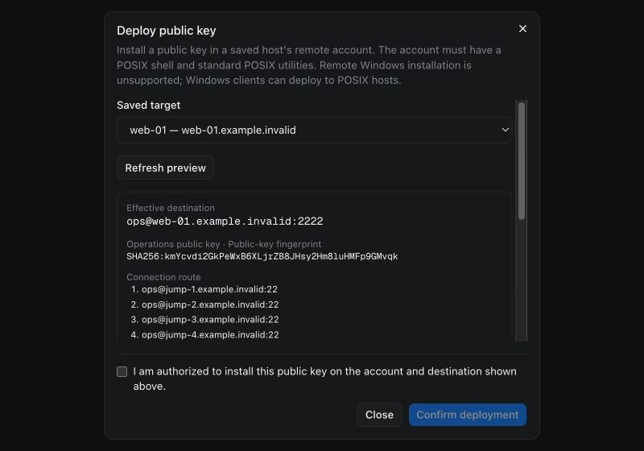
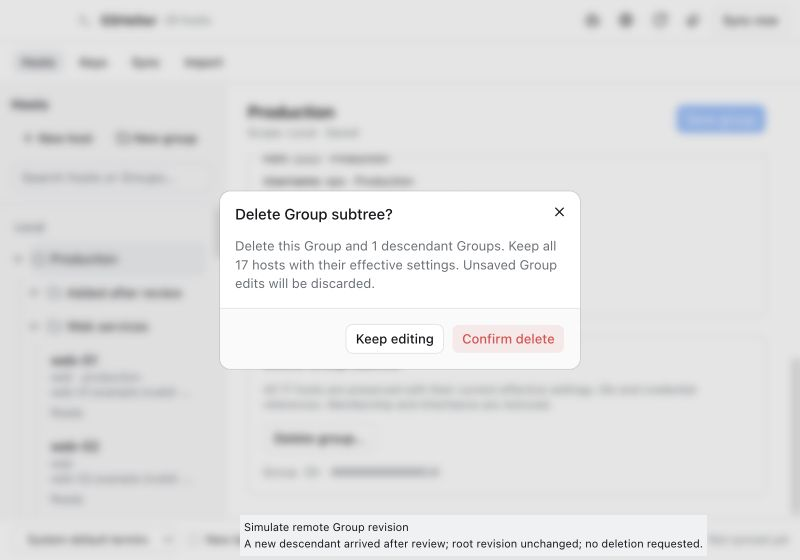

# Mounted component visual references

Actual React components with public, fake native transport fixtures. These are presentation evidence, not real host authentication, permission grants or native Windows popup acceptance. Host-key images are the prior Beta UI retained in Beta 3; other source details are in the task visual receipts. Original files were copied without editing.

## Previous Beta: first-contact server identity, light, 480×320.

## Previous Beta: changed server identity, dark, 480×320.

## Groups and effective inherited host fields, dark, 1100×720.

## MCP Ask approval with a long public command, dark, 800×560.

## Public-key deployment with a long route and fixed actions, dark, 800×560.

## Final Group deletion confirmation, light, 800×560.

