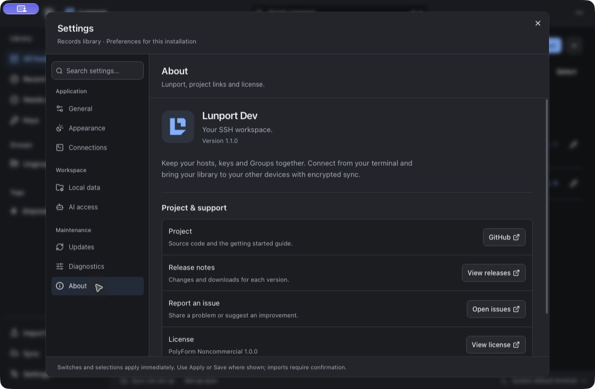
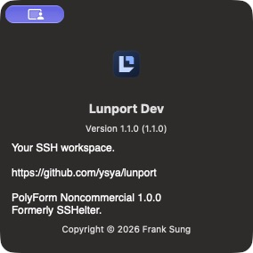

# Lunport 1.1.0 release validation

## Windows runtime repair

The earlier native cleanup failures recorded in [About validation](../2026-10-17-lunport-about-docs.md#ci) were a release blocker. Moving tray/menu work onto the UI thread did not resolve concurrent runtime handle ownership.

`AppHandle::clone` reaches `tauri-runtime-wry::Context.main_thread`, whose derived clone copies a Tao Windows window target backed by `Rc<EventLoopRunner<_>>`. Concurrent background clones/drops race that non-atomic count. The vendored 2.11.2 runtime retains the original dependency versions and changes that payload to `Arc`; [patch provenance](../../src-tauri/vendor/tauri-runtime-wry/LUNPORT_PATCH.md) records the exact upstream archive and the two source hunks.

The isolated test creates no tray, menu, WebView, sync account or credentials. Four workers each clone/drop 25,000 actual AppHandles, then join before native loop cleanup. CI rejects a missing test and fails on the first failed process; it does not retry a failing candidate until green.

| Source | Check | Result |
| --- | --- | --- |
| `1eed4200327ba128712f506e347028bf9a4ce7d4` (test added; original runtime) | [Handle-only baseline](https://github.com/ysya/lunport/actions/runs/38970867684/job/117208637026) | First process aborts in `alloc/src/rc.rs:3781`, unsafe precondition violation, `0xc0000409` |
| `a73067a8f20f75f034dffb98af7cfbcde4b4832e` (shared context) | [Handle-only candidate](https://github.com/ysya/lunport/actions/runs/38970867684/job/117208637411) | 10/10 processes pass; 1,000,000 clones total; normal cleanup |
| `e977a03317a90a5203e00bc572bb61f4207348ef` (original main) | [Native tray baseline](https://github.com/ysya/lunport/actions/runs/38970871083/job/117208648350) | Nine processes pass; tenth aborts with `0xc0000374` heap corruption |
| Same candidate | [Native tray/visibility candidate](https://github.com/ysya/lunport/actions/runs/38970871083/job/117208647974) | 10/10 processes pass |
| Same runtime, local macOS | Complete safe Rust suite with required real OpenSSH | 2,601 passed, 0 failed, 10 filtered |

The paired handle workflow has an expected failed baseline; candidate jobs are the repair evidence. [Machine-readable receipt and diagnostic excerpts](1.1.0-review/runtime/comparison.json) retain both outcomes. The separate full Windows workflow also runs the new isolated regression and the original tray, GUI, console and OpenSSH checks.

## Release gate

Product candidate: `07f6b4c5013fb0d2f8d76b513f02b23c05869689`. The final documentation commit changes only `docs/`; product sources, version files, dependency locks and installer inputs remain identical to this tested candidate.

| Validation | Result |
| --- | --- |
| [Frontend, macOS and Linux](https://github.com/ysya/lunport/actions/runs/38972304863) | Frontend 84 files / 1,071 tests and production build; macOS 2,601 Rust tests; Linux 2,596 Rust tests plus seven real PAM tests; three profile selections per platform all pass |
| [Windows full suite](https://github.com/ysya/lunport/actions/runs/38972304718) | Complete safe suite, all three profiles, whole app, handle regression, ten tray processes, native crash metadata, actual Development GUI, console helper, real console and OpenSSH all pass |
| [Linux package upgrades](https://github.com/ysya/lunport/actions/runs/38972304748) | Published 1.0.0 DEB/RPM replaced by 1.1.0 Lunport; existing data sentinel and `/usr/bin/sshelter` retained |
| [Windows installers and upgrades](https://github.com/ysya/lunport/actions/runs/38972301193) | Full 1.1.0 production NSIS/MSI build; installed helper/GUI pair in pipes and real consoles; 1.0.0 to 1.1.0 upgrade on a fresh runner; old paths, data, shortcuts, login preference, CLI and uninstall behavior verified |
| Native macOS Development 1.1.0 | TypeScript/Vite and native bundle pass; Settings About and native About verified; existing two disposable hosts and one key retained; quit normally and confirmed not running |

[CI receipts](1.1.0-review/ci/) pin every run to the candidate. [Windows candidate checksums and rendered installer identities](1.1.0-review/installers/) match that source. Production bundle ID and updater key are unchanged from v1.0.0. The local GUI check used Development only, without editing records or preferences.

All prepublication gates passed. [Lunport 1.1.0](https://github.com/ysya/lunport/releases/tag/v1.1.0) is published as Stable from `d1a77544f223794d8a88c2c3cdae211f99ad15e9` (release ID `415423705`). The tag tree equals the final release PR tree; differences from the tested product candidate are documentation only.

## Published release

- [Official release workflow](https://github.com/ysya/lunport/actions/runs/38974581595): all four build legs and Beta channel update passed. Exact-tag [engine/frontend](https://github.com/ysya/lunport/actions/runs/38974581685) checks and every functional [Windows](https://github.com/ysya/lunport/actions/runs/38974581735) step also passed.
- All 20 assets downloaded; nonempty/uploaded state, size and GitHub SHA256 match. Fifteen platform aliases reference nine unique updater packages. Each package passed the updater's `minisign-verify 0.2.5` verification with legacy signatures disabled; each modified copy was rejected. Manifest signatures equal the uploaded signature files.
- Stable and Beta public manifests match the release. Both original `ysya/sshelter` updater URLs also resolve to the same 1.1.0 manifests, preserving updates from existing installs.
- Published macOS archive contains x86_64 and arm64, Lunport 1.1.0 metadata, the exact Folded L icon from source, and the retained bundle ID/executable. The arm64 linker ad-hoc signature verifies. The existing unsigned/non-notarized distribution policy is unchanged; this is separate from cryptographically signed updater packages. No Production GUI was launched locally.
- Historical v1.0.0 tag, release body, asset IDs/names/sizes/digests all match the frozen baseline. Its 20 installers/signature/manifest assets were not replaced.

[Publication receipts](1.1.0-review/publication/verification.json) include the exact release/tag/channel snapshots and artifact results. [Reproduction instructions](1.1.0-review/README.md) describe the public-key verifier.

Publication verification uses [verify-publication.mjs](1.1.0-review/verify-publication.mjs) and `minisign-verify = 0.2.5`, the updater's own verifier version. It checks the exact tag commit, 20 asset digests, 15 manifest platform aliases, nine unique updater signatures and tampered-copy rejection, Stable/Beta manifest equality, and immutable SSHelter 1.0.0 asset/tag identities.
